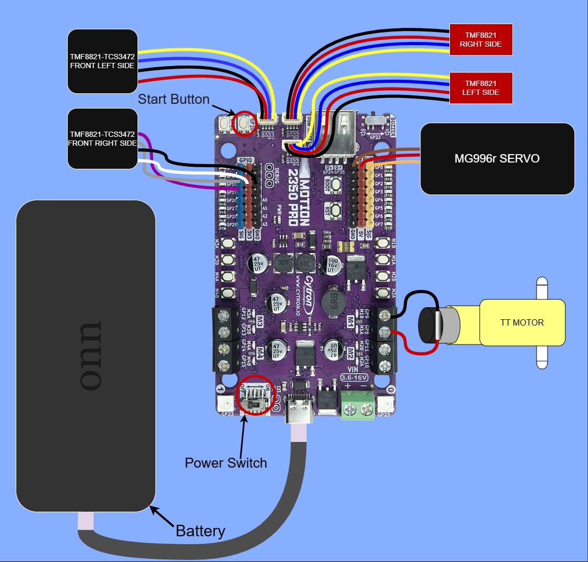
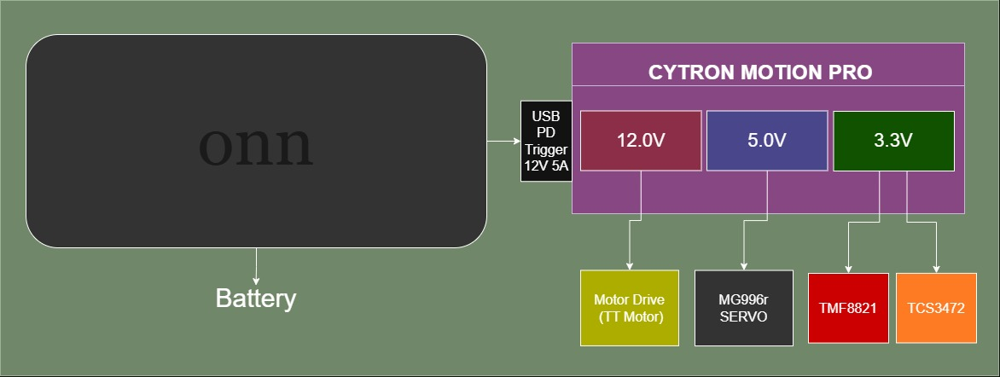
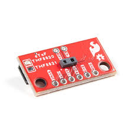
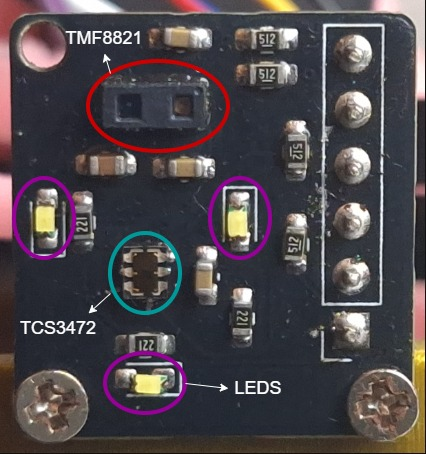
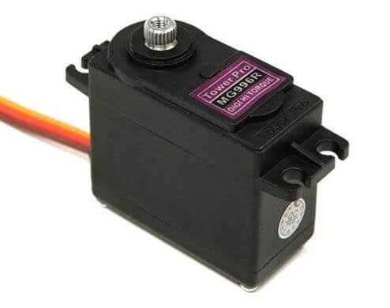
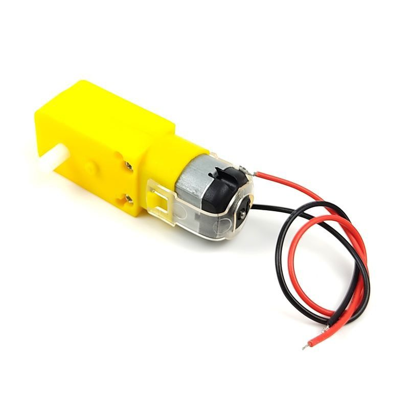
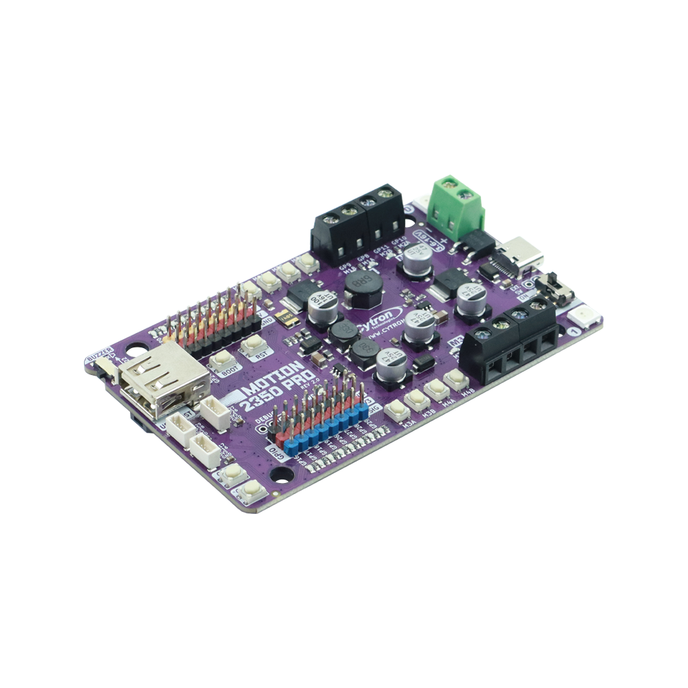

# Electrical Design 

In this document you will find all the things about the electrical components like the capacity of the sensors, the battery, and how is designed the electrical on the robot.

## Introduction

Our electrical design consists of the amount of 6 sensors, with which our car is capable of flawlessly driving through the track without much difficulty. The hardware of our choice are: 

- 2 TCS3472-TMF8821 sensors on the front for effective color detecting and distance reading.
- 2 TMF8821 distance sensors on the sides of the robot, one on each side for maintaining the car as centered through the track.
- MOTION PRO RP2350 which programmed in micropython is more than capable of handling every sensor on the list.
- A trusty TT motor for driving.
- An sturdy MG996r servo motor for steering.  

But this is too simple, right? Just using some generic hardware to make our car drive is too basic for us engineers? Well of course, we can do more, we can do better, and that is why we are designing our own sensors for future competitions. As a matter of fact, we ALREADY have the schematics for a mix of the powerful TCS and TMF sensors (designed by us) in one board and we plan on making the best hardware we can for our needs in this competence. 

 ## Robot Composition 

The robot is composed of 6 sensors that are distributed in all the robot. These sensors help the robot to know where he goes, what he have to do, and when he have to stop. Sensors are, in few words, the eyes, hands, and ears of the robot. 

The chosen hardare for the robot were:

| Hardware | Brief Description | Specifications | Library |
|--------|-------------------|----------------|---------|
|TMF8821| Distance Sensor | [ams TMF8821 configurable 4x4 multi-time dToF](https://ams-osram.com/products/sensor-solutions/direct-time-of-flight-sensors-dtof/ams-tmf8821-configurable-4x4-multi-zone-time-of-flight-sensor)| [tmf8821.py](Code-Development/lib/tmf8821.py) |
|TCS3472| Color Sensor | [TCS3472 Datasheet](https://cdn-shop.adafruit.com/datasheets/TCS34725.pdf) | [tcs3472.py](Code-Development/lib/tcs3472.py) |
|MG996r SERVO| Servo | [MG996r Servo Datasheet](https://components101.com/sites/default/files/component_datasheet/MG996R%20Datasheet.pdf)| [servo.py](Code-Development\lib\servo.py)|
|TT Motor| Motor Driver | [adafruit TT Motor](https://www.adafruit.com/product/3777?srsltid=AYCX9vK63V0uk5SSyk0xiIwCBCs62URFzfz7q9NVskcAyXs2BLx0SNXz) | [dcmotor.py](Code-Development/lib/dcmotor.py)|
|Cytron Motion Pro RP2350| Microcontroller | [Cytron Motion Pro RP2350 Datasheet](https://www.cytron.io/p-motion-2350-pro?srsltid=AU7gw4W5Ifi1J22W_zTflltF3oPrDEIvFmEJ27_g_rW_nqw14TCFXhvm)

## [Wiring Diagram](Electrical_Diagrams/Wiring_Diagram_New.jpg)

## Power Architecture

| Hardware | Voltage | Approximately Consumption | Provided Energy by  |
|----------|-------|---------------------------|--------|
| MOTION PRO RP2350 (microcontroller) | 5.0mAh - 35.0mAh | 30mAh - 60mAh | Battery| 
| TMF8821 (distance sensor) | 2.7V (min) - 3.5V (max) | Active Ranging: 57mAh |Regulator 3.3V |
| TCS3472 (color sensor) | 2.7V (min) - 3.6V (max) | 15mAh - 20mAh | Regulator 3.3V | 
| MG996r (servo) | 4.8V (min) - 7.2V (max)| Operating Current (Under load): 500mAh - 900mAh| Regulator 5.0V|
| TT Motor (motor) | 3.0V (min) - 7.5V (max) (optimal: 6V)| Normal Operating Current: 200mAh - 250mAh / Stall: 1200mAh - 1500mAh | Regulator 12.0V  | 

## Power Budget

Work in Progress

## Hardware description, selection, and placement!

All the information about the hardware of the robot (sensors, motors, microcontroller, and battery) is located right below this text:

  

  

     TMF8821 (click to expand)
  

   
  
  

  

  ### ams OSRAM TMF8821
  

  ### What it is?

  The ams OSRAM TMF8821 is a compact multi-zone direct Time-of-Flight (dToF) optical sensor measuring precise distances from 10 mm to 5,000 mm at up to 30 Hz. Housed in a tiny 4.6 mm x 2.0 mm x 1.4 mm package, it integrates a 940 nm Class 1 eye-safe VCSEL, a high-sensitivity SPAD array, and on-chip histogram processing to support configurable 3x3, 4x4, or 3x6 grids with a 63° field of view. Communicating over I²C, this high-performance module features sunlight immunity and dynamic cover glass calibration, making it ideal for smartphone laser autofocus, presence detection, and robotics.

  ### Why we decide to use it?

  We decide to use the TMF8821 distance sensor for the robot. Why we choose this? Well, after using other distance sensors like the Vl53l0x and the Vl53l1x (V-1.4 and past versions), or the hcsr04 distance sensor (V-1.3 and past versions), the one who give us better results in reading distance it was the TMF8821. It ensures better readings than the others, specifically better readings when its time to read the black walls of the circuit. For this reason, we decided to keep and use the TMF8821 in the robot, seeking for the best readings and more accuracy.

  ### Ubication

  - Frontal TMF8821 sensors: The front TMF sensors are located in the center of the robot’s front section, positioned on a platform tilted at a 45-degree horizontal angle. These sensors are neither too close to the ground nor too high; they are situated at almost the same height that of the top of the wheels. These sensors help us to detect the obstacles of the track (walls and pillars).
             
  - Lateral TMF8821 sensors: Each of the lateral TMF sensors are located in the center of the robot sides. Like in the front, they are situated at almost the same height that of the top of the wheels. These sensors help us to mantain the robot centered and know when the robot has to turn and where.

  

  

  

     TCS3472 (click to expand)
  

   
  
  

  

  ### TCS3472
  

  ### What it is?

  The TCS3472 is a high-precision digital color light-to-digital converter featuring a 3×4 photodiode array and four integrated 16-bit analog-to-digital converters for simultaneous RGBC measurement. Equipped with an on-chip infrared blocking filter and an I²C interface, it enables accurate chromaticity analysis and ambient light sensing under varying illumination conditions.

  ### Why we decide to use it?

  For the color sensor we decided to use the TCS3472 for the robot. In the past, we were using the APDS9960 (V-1.4 and past versions), but in some tests, we seen that some readings were not accurate and the robot get confused with the colors, making the computer take erroneus decisions. Because of this, in this new version we changed to the TCS3472 to secure more accurate readings. The TCS3472 provide us better readings and this helps the computer to identify the colors faster, precise and take better decisions.

  ### Ubication

  TCS3472 sensors are located in the same plataform that the TMF8821 frontal sensors, so they have the same inclined horizontal angle of 45 degrees and are situated at almost the same height that of the top of the wheels. TCS3472 sensors are the one's in charge of reading the color of the pillars.

  

  

     MG996r Servo (click to expand)
  

   

  

  

  ### MG996r Servo
  

  
  ### What it is?
  
  The MG996R is a 55g digital servo featuring high-strength brass/aluminum gears and a dual ball-bearing output shaft that eliminates axial play under load. It operates at 4.8V–7.2V, pulling up to 2.5A at stall, and delivers a torque of 9.4 kg·cm (4.8V) to 11 kg·cm (6V) with speeds of 0.17s to 0.14s per 60°. Controlled via a 50Hz PWM signal (500µs–2500µs pulse width for 180° rotation), it utilizes an upgraded internal IC to ensure a tight 5µs dead band, delivering precise positioning and superior holding torque for heavy-duty robotics and RC systems.

  ### Why we decide to use it?

  Initially, we used the SG90 servo motor, but it didn't work because the robot required more torque to move correctly. We therefore looked for a similar alternative that met the necessary requirements and found the MG996R servo motor—the perfect choice for us.

  ### Ubication

  MG996r Servo is located is located a bit further ahead of the robot's center—roughly halfway between the center of the robot and its front. The MG996r Servo is the one intended to make the robot turn and enable it to maneuver along the track.

  

  

     TT Motor (click to expand)
  

   

  

  

  ### TT Motor
  

  
  ### What it is?
  
  A TT motor (Track & Tower motor) is a compact, low-cost brushed DC gearmotor featuring an integrated plastic gearbox (typically with a 1:48 or 1:90 reduction ratio) that operates between 3V and 6V DC to deliver a balance of high torque (around 0.8 kg·cm) and manageable speeds (90 to 200 RPM).

  ### Why we decide to use it?

  We decided to use the TT motor because, in previous tests, other motors burned out and failed to meet the required standards. When we tested the TT motor, it met our needs, so we kept it and decided to use it in the robot.
  ### Ubication

  The TT motor is located between the center of the robot and its rear, specifically on the underside of the chassis on the left side. TT motor is the one destinated to make the robot move forward and backwards.

  

  

     Cytron Motion Pro RP2350 (click to expand)
  

   

  

  

  ### Cytron Motion Pro RP2350
  

  
  ### What it is?
  
  The Cytron MOTION 2350 Pro is a beginner-friendly robotics controller powered by the dual-core Raspberry Pi RP2350 microcontroller, operating between 3.6V and 16V. Designed for rapid prototyping, it drives up to 4 brushed DC motors (3A continuous/5A peak) and 8 servos, while featuring 3 Maker Ports, an onboard USB-A host port for gamepads, and physical quick-test buttons for no-code hardware testing. It comes preloaded with CircuitPython and fully supports MicroPython, C/C++, and Arduino IDE, making it a highly accessible all-in-one solution for building mobile robots and smart hardware projects.

  ### Why we decide to use it?

  Of all the microcontroller we could have choosen, we decided to go with the Cytron Motion Pro RP2350. This microcontroller provide us more than we need; it's a fast, precise, and easy to use microcontroller, guaranteeing us that all the information would be processed and analyzed to take the refined decisions.

  ### Ubication

  The Cytron Motion Pro RP2350 is located in the center of the robot, at the top, just above the battery. The microcontroller Cytron Motion Pro RP2350 is the one who takes all the decisions, process all the data, and tells the robot what to do.

  

     onn Portable Power Bank (click to expand)
  

   
  
  

  

  ### onn Portable Power Bank (model WIABLK36009632)
  

  ### What it is?
  
  The battery we decided to use is a onn Portable Power Bank (model WIABLK36009632). It has a capacity of 10,000 mAh, an storage capacity of 38.5 Wh, and a 20W fast-charging output. It can supply 29 Wh continuos, providing us with more than we need. 

  - This power bank includes dual USB-C ports and one USB-A port, it has an approximate weight of 0.44 lb (200 g) and dimensions of 4.53 x 2.76 x 0.63 inches, making it easy to carry. 
  - It features an internal voltage of 3.85V (the nominal voltage for lithium cells), but regulates its output to 5V, 9V, and 12V via its ports.
  - Furthermore, this battery includes protection against short circuits and overloads, ensuring that no issues will arise.

  ### Why we decide to use it?

 We decide to use the onn Portable Power Bank and change the battery JUOVI we had in the past because the JUOVI battery got damaged and did not work. We needed a replacement that was easy to find and quick to acquire; that’s how we came across the onn Portable Power Bank battery, which was exactly what we needed.

  ### Ubication

  The onn Power Bank is located at the top of the chassis of the robot, just below the microcontroller Cytron Motion Pro. The reason of the battery being here is that is more easy to take it out if we need to charge it and it is more easy to connect it to the microcontroller. The onn Power Bank is the one in charge of giving energy to the robot to be able to make all the track.  

## Sensors Configuration

Work in Progress

## Noise, interference, and faults

<table>
  <thead>
    <tr>
      <th width="40%"> Possible Cases</th>
      <th width="60%"> Solutions</th>
    </tr>
  </thead>
  <tbody>
    <tr>
      <td><b> Voltage drops </b></td>
      <td>
        

          
 Description (Click to expand) 

          
 It will be very normal if a voltage drop occurs. But that will not be any problem. The microcontroller Cytron Motion Pro RP2350 counts with regulators of 3.3V, 5.0V, and 12.0V, that will be always regulating the voltage that the sensors receive. Therefore, the Cytron Motion Pro already protect us from this cases. 

        

      </td>
    </tr>
    <tr>
      <td><b> Unstable readings </b></td>
      <td>
        

          
 Description (Click to expand) 

          
It is common to have unestable readings in the TMF8821 and TCS3472. To solve this in case that happens, for the TMF8821 sensors the computer creates filters and averages that ensures the most precise reading, while for the TCS3472 sensors the rpbot approach until a distance that the TCS3472 sensors can read correctly the color. 

        

      </td>
      <td>
    <tr>
      <td><b> Interference between sensors </b></td>
      <td>
        

          
 Description (Click to expand) 

          
 When determining the appropriate placement for the sensors, we took into account potential interference between them. Consequently, we ensured that no sensor would interfere with the others. The TCS3472 sensors are positioned with an angular separation of 45 degrees, which prevents their readings from coinciding. A similar approach was taken for the TMF8821 sensors: they are also spaced at a 45-degree angle, preventing their readings from overlapping or causing interference. Furthermore, each sensor is connected to separate pins, ensuring that communication channels do not conflict or provide misleading data to the computing system. 

        

      </td>
    </tr>
    <tr>
      <td><b> Lighting changes </b></td>
      <td>
        

          
 Description (Click to expand) 

          
 Changes in lighting are very common. The TCS3472 is unaffected by these changes, thanks to its precise reading distance and the LEDs integrated into the sensor itself. The situation is different for the TMF8821: this sensor is significantly affected by variations in lighting. Despite implementing filters, calculating averages, and configuring the device, the TMF8821 continues to show instability in response to changes in lighting.  

        

      </td>
    <tr>
      <td><b> Improperly connected cables </b></td>
      <td>
        

          
 Description (Click to expand) 

          
 All the cables are visible, so if any were improperly connected, we would see it. Furthermore, when the sensors were connected, special attention was paid to how the wiring was organized; as a result, all the cables are neatly arranged and easy to identify. 

        

      </td>
    </tr>
    <tr>
      <td><b> Sensors blocked by parts of the chassis </b></td>
      <td>
        

          
 Description (Click to expand) 

          
 None of the sensors are located on a part that can be obstructed by any part of the chassis or the robot. As a consequence, none of the sensors may be obstructed by the robot itself. 

        

      </td>
    </tr>
  </tbody>
</table>

## Recent Changes

- VL53L0X for TMF8821
- APDS9960 for TCS3472
- BNO085 for BMI270
- Discard BMI270
- Discard HuskyLens 2
- Battery JUOVI for onn Power Bank

### <u>[Back to the top!](#introduction)<u>

