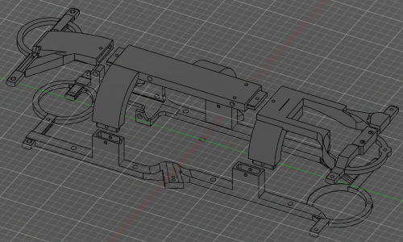
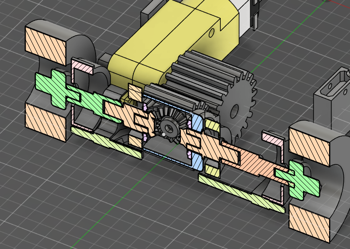
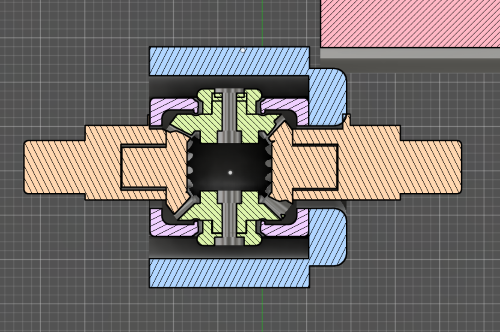

# Mechanical Engineer

In this document you'll find all the things related to the mechanical engineer like the mobility system, components of the car, and others.

## About Our Car

Our trsuty EC26 is a rear wheel drive vehicle designed entirely our mechanical engineer with Fusion 360 CAD software. This modular vehicle was made with upgradeability and reliability in mind. This is the smallest design made by me (Efrain Ortiz) and the best so far. Its composed by a custom made differetial and steering system (in this case a rack and pinion) drived by a plastic gearbox 1:48 TT motor (the yellow gearbox) and a MG996R servo motor for positional precision on the steering drive.

## Current Model Photos (V-1.5)

<table>
    <tr> 
        <td> 

        <!-- Image -->
         
  <!-- The Text Overlay -->
  

    <b> Bottom </b>
  

        </td> 
        <td> 

        <!-- Image -->
         
  <!-- The Text Overlay -->
  

    <b> Back </b>
  

        </td>
        <td> 

        <!-- Image -->
         
  <!-- The Text Overlay -->
  

    <b> Front </b>
  

        </td>
    </tr>
    <tr> 
        <td> 

        <!-- Image -->
         
  <!-- The Text Overlay -->
  

    <b> Left </b>
  

        </td>
        <td> 

        <!-- Image -->
         
  <!-- The Text Overlay -->
  

    <b> Top </b>
  

        </td>
        <td> 

        <!-- Image -->
         
  <!-- The Text Overlay -->
  

    <b> Right </b>
  

        </td>
    </tr>
    </table>
  

## Hardware location

  - The MOTION PRO RP2350 is located on top of the chassis alongside the battery. Before the front part is located the TT motor (drive motor) and the MG996r servo motor for steering. On both sides the car has TMF8821 sensor to read distance. On the front the car has with our custom tmf+tcs sensors for color and distance detection.

### The body (chassis)

  - The chassis was designed around the drive train, this means that we made sure everything had space before designing the body, the only exception is the oval shape on the differential area that was added later because we had to rework the differential multiple times. 

  - The chassis was made modular to be easily modified. Also print times and quality are highly improved with a modular design as it can be oriented in ways it takes less support and less movement on the Z axis(up/down).

      

### Drive train

  - The car is rear wheel drive for simplicity. Rear wheel drive does not require rotations a angles in this type of vehicle, so it is simpler as we can skip designing universal joints. The driven by a TT motor(1:48) directly coupled to a differential.
  - Another thing to note is that the axle  halves are asymmetrical, this is a trade-off as we decided to prioritize time over comfort because of the problems with the differential.
  - 
     

### Steering design

  - The steering was another headache to make, like the differential, it was also reworked multiple times. But it came up to be a rack and pinion system for stability, precision and just looks cooler. Even though we tried to achieve ackermann steering it got messed up when we decided to accommodate the servo upfront, but after testing we realized it did not really matter much at that scale, maybe you get outer wheel 1 or 2 degrees of more turn which you cant even see on track. As it was not a issue we did not waste time correcting it.    

## Design Trade-Off

Some trade offs can be found on the steering system, differential, chassis design and choice of actuators.

### Steering System

  - Some common problems with a rack and pinion system is space, it takes more space than other more simple methods, but it also has a better torque transfer and is very stable. our design also has a limited turn radius (±25°to 30°) but this can be modified with the gear ratio and rack length. This isn't really a limiter factor at our application as it has not given us much trouble at the challenge.

### Differential

  - Limited max speed as the differential itself lacks bearings and can melt on higher speeds (~200rpm+) even if greased (which is the highly recommended), this was tested by us using a drill to spin the gears at speeds higher than 500rpm (~1000 to 1500 rpm during 1 minute) and surprisingly the differential was still working even after some melting. Our choice of designing our own differential was more of a personal challenge to learn than an actual strategic decision for better performance, still the results do satisfy our needs in the challenge.

      

### Chassis design

  - The choice of making the chassis a modular one make us be able to modify parts of the chassis without having to print the whole thing again. The chassis may look a little funny as it contains some big ovals at the differential place, this is because making the differential smaller was taking too much time mainly because of problems with the print quality at small scales with a .4mm nozzle. The only trade off of this wacky design is just it being more prone to braking, otherwise is just some esthetic preference.

