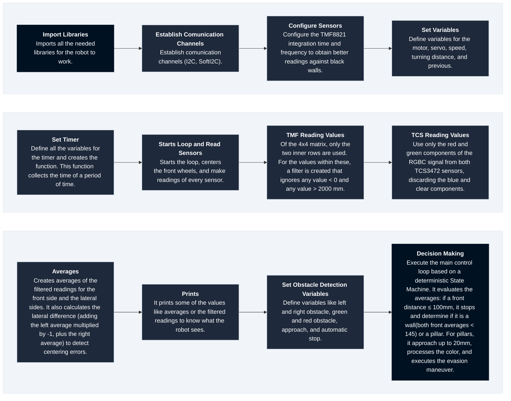
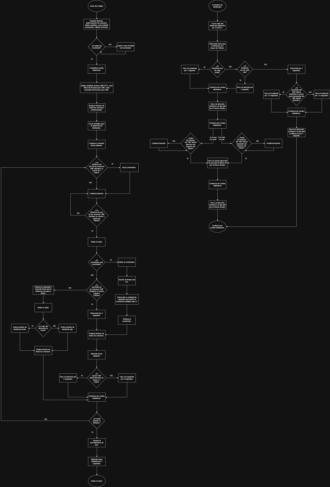
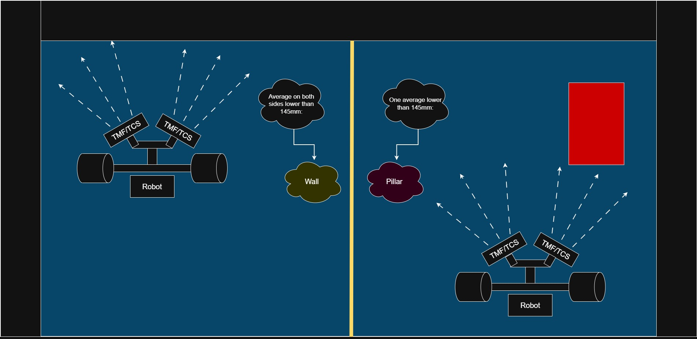
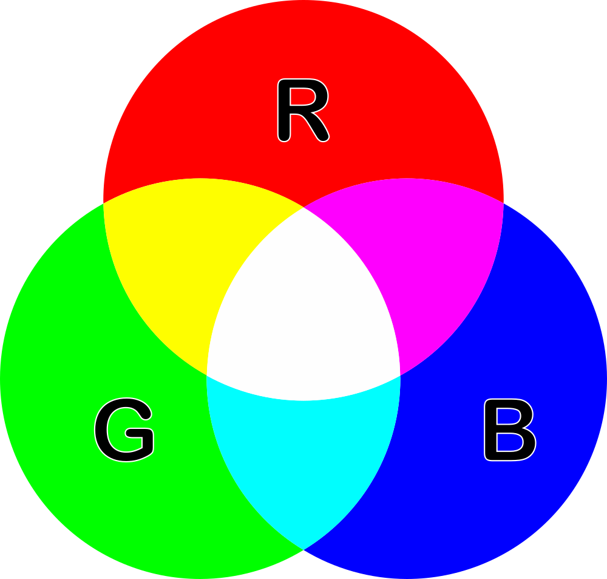
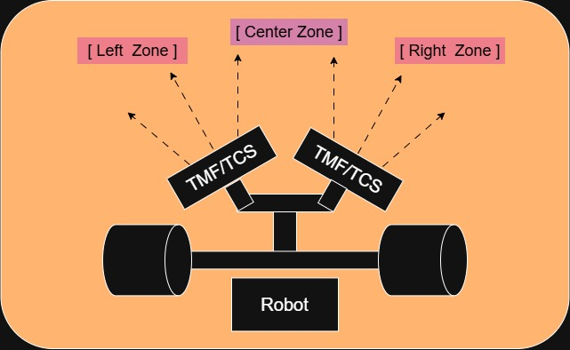

# Software Architecture and Obstacle Strategy

 In this document you will find all the explanation about the code, obstacle strategy and decision making.

## About the Code 

The robot's code is designed to complete all the challenges of the WRO Future Engineers 2026 competition circuit. The code was created on the app Thonny, an IDE for Python and Micropython, in which we programmed and created the brain of the robot. The microcontroller we decided to give life to the robot is the [Cytron Motion Pro RP2350](https://www.cytron.io/p-motion-2350-pro?srsltid=AU7gw4W5Ifi1J22W_zTflltF3oPrDEIvFmEJ27_g_rW_nqw14TCFXhvm).

To upload the code to the microcontroller: 
- #### 1. Connect the microcontroller to your computer using a USB cable.
- #### 2. Turn it on.
- #### 3. Open your IDE (in our case, Thonny).
- #### 4. Make sure the microcontroller is recognized.
- #### 5. Press the right click on the program you want to upload and select save.
- #### 6. Once saved, the code is successfully uploaded to the microcontroller.

## Table of Content:

### 1. <u> [Software Organization](#software-organization) </u> 
### 2. <u> [State Machine](#state-machine) </u> 
### 3. <u> [Algorithms](#algorithms) </u> 
### 4. <u> [Obstacle Strategy](#obstacle-strategy) </u> 
### 5. <u> [Edge Cases](#edge-cases) </u> 

## Software Organization 

## State Machine

The State Machine is detailed and documented using a [flowchart](Code_Diagrams/Flowchart.jpg). 

## Algorithms

Our robot does not use PID, an IMU, or artificial intelligence to navigate the circuit. Instead, it finds its way along the course by utilizing and processing data from TMF8821 and TCS3472 sensors.

  

    TMF8821 Data Processing (click to expand)
  

   
  
  The TMF8821 is a highly flexible sensor that enables a robot to perceive its surrounding environment. Its field of view is divided into several matrices, which ensures that the robot can orient itself correctly on the track.
  
  Among the available options, we use a 4x4 matrix, from which the robot processes only the central rows—specifically, the second and third rows.

  - The top row is discarded because it carries a higher risk of yielding erroneous data; the sensor might detect elements outside the track, which would compromise the other readings.
  - A similar logic applies to the bottom row, which is also excluded: the sensor is likely to pick up the track surface itself, producing false readings that would interfere with the rest of the measurements.

  ### How this values are processed?

  The readings of these rows of the frontal TMF8821 sensors, are combined creating filters for discard and averages. The robot takes all the values of these rows and pass them in a filter that ignores any value same to 0 ir greater than 2000mm (2m). After that, the robot realize an arithmetic average of that filtered readings to obtain an precise average of the values. This average and filtered readings are the ones that the robot uses continuously to determine the distance.

  ### How the robot knows when it detects something?

  The exact distance in which the robot activates the condition of "detected obstacle" is when any of the readings of the frontal TMF8821 marks 100mm (10cm). At this distance, the robot stops inmediatly and identify "do I have in front a wall or an obstacle?".

  ### How the robot distinguish between a wall and an obstacle?

  

  
  

  The robot way to identify this is with averages: if the average of both readings of both frontal TMF8821 is lower than 145mm (14.5cm), the robot knows that it is a wall, therefore it do  not approach to identify the obstacle color. 
  - The robot analysis is: "if both of the averages of the frontal TMF8821 are lower than 145mm, then means that there is something in front that has a greater length than of a pillar, so it is a wall". 

  In case of both averages not being lower than 145mm, the robot determines that what is in front it is not a wall, but a pillar; therefore, it approaches until there is a distance of 20mm (2cm), correct distance to identify the color in a precise way.

  

    TCS3472 Data Processing (click to expand)
  

   

  For the TCS3472 color sensor readings, we calculate proportions of the colors to define what color the robot is really seeing. The TCS3472 sensor have an precise measure distance of 10mm-20mm (1cm-2cm); therefore, to determine the color correctly, the robot approaches to the detected obstacle.

  

  
  

  Of the values ​​provided by the TCS3472, we only use those corresponding to the red and green ranges. 
  - It is not necessary to read the blue component, as it is not among the predefined colors of the track pillars, and the sensors do not detect the lines on the ground.

  - Furthermore, the "Clear" channel (white light/unfiltered channel) is not used, as the sensor includes built-in white LEDs that create a controlled lighting environment; this eliminates the need to calibrate the front sensors in response to changes in ambient lighting conditions.

  ### How the robot determine the color of the pillar?

  The color identification is realized comparing the max values of red and green obtained from both of the TCS3472 sensors in every reading. The algorithm selects the color determining what of these max values is greater:
   - If the max value of green is greater than the max value of red, the robot determine that is seeing an obstacle color green, and vice versa.

  ### TCS3472 sensors are part of the follow-up lane procedure? 

  Our robot does not use a rail or lane painted on the ground to guide its trajectory; therefore, the TCS3472 is not used for the follow-up route. Instead, the rail is defined geometrically by the track walls. 
  
  The robot keeps itself centered in a mathematical way: when the side TMF8821 detects that the walls opened (greater distance than 1 meter), an internal chronometer that measures the time of moving forward until finding a frontal wall is activated. When it stops, the robot goes backwards exactly the measured time divided by two (recent_time / 2).
  
   This time and distance threshold ensure that the robot stay perfectly positioned on the central axis of the physical rail before executing the turn.

## Obstacle Strategy

### Detection and Proximity Control 

The robot will stop if any of the readings of the TMF8821 frontal sensors are same or less than 100mm. If the readings are less than 100mm, the robot will stop and depending the thing that detects, it would take different decisions:

- If it detects a wall: the robot will go backwards for a stablished period of time and then will continue with the program regularly.

- If it detects an obstacle: the robot will reduce the speed and will approach to the obstacle until there is a distance of 20mm between the obstacle and the robot. At that distance, the robot will read the color of the obstacle using the TCS3472 sensors.

### Pillar Localization 

To determine the position of the obstacle, the robot counts with 2 TMF8821 frontal sensors with an angle of 45 degrees. With this, we ensure the robot has a good point of view.

One of the TMFs read mostly the left side and the other the right side, making easy to determine if the obstacle is at the right or the left side. 

To determine if is in the center, we uses the most close values to the center from the TMFs, being this the values further to the right in the TMF8821 inclined to the left and the values further to the left in the TMF8821 inclined to the right. 

### Rule Compliance and Decision Logic

To remain in compliance with the rules, the robot must not collide with any of the track's walls, nor may it displace any of the pillars from their positions. Also, it will determine the direction based on the color of the pillars:

- Green Pillar: The robot must dodge it to the left side. 
- Red Pillar: The robot must dodge it to the right side.  

Finally, if the robot detects an obstacle, it must stop and identify the color: if it is green, the robot turns left, and if it is red, it turns right.

### Lane Reincorporation

The robot will know it can return to the lane when it already pass the obstacle. To know when it pass the obstacle, the robot will be reading with the TMFs side sensors the distance. When all the readings are more than 100mm, the robot will know that it already pass the obstacle and can return to the lane. The robot will return to the lane by turning in the opposite direction to the one it took initially.

### Fault Tolerance 

If a sensor stops working, the procedure will be differnt depending on the context.

- Before the competence: The protocol will be determine the cause of the problem (bent cables, non-functioning cables, improperly connected cables, faulty sensors, etc.) for then solve the problem before start competing.
- In competence: The robot would stop to avoid making incorrect decisions and failing to comply with the rules.

## Edge Cases
<table>
  <thead>
    <tr>
      <th width="40%"> Possible Cases</th>
      <th width="60%"> Solutions</th>
    </tr>
  </thead>
  <tbody>
    <tr>
      <td><b> Obstacle Appears Partialy </b></td>
      <td>
        

          
 Description (Click to expand) 

          
 If an obstacle appears partialy, there isn't any problema at all. The robot have stablished that if any of the TMF8821 frontal sensor lectures is less of 100mm, it should stop. If an obstacle appears partialy, even so a part of the sensor would detect it and therefore it should stop. To determine the color of the obstacle, the robot approach to the obstacle until there is a distance of 2cm between the robot and the obstacle to read the color correctly. 

        

      </td>
    </tr>
    <tr>
      <td><b> Obstacle too close </b></td>
      <td>
        

          
 Description (Click to expand) 

          
If the robot approach too much to an obstacle, the robot would immediately stop and then go backwards until be at a good distance for reading colors and a good distance for handle to evade the obstacle. 

        

      </td>
      <td>
    <tr>
      <td><b> Robot lost lane </b></td>
      <td>
        

          
 Description (Click to expand) 

          
 By continuously measuring the distances to the sides, the robot can determine whether or not it is in the lane (the center of the track). If it veers off course or loses the lane, the robot triggers an automatic centering function, which causes it to turn toward the side with the greater distance, thereby returning it to the center of the track. 

        

      </td>
    </tr>
    <tr>
      <td><b> Sensor return 0 or imposible value</b></td>
      <td>
        

          
 Description (Click to expand) 

          
 It is common for TMF8821 sensors to exhibit a margin of error or produce incorrect readings. For this reason, we have implemented filters that discard any value equal to 0, or greater than or equal to 2000 mm. This allows us to avoid excessively high readings or impossible values ​​(such as 0). Furthermore, the system calculates an average based on these filtered readings; in this way, if an erroneous reading occurs, it is compensated for by the other values, ensuring the highest possible level of accuracy. 

        

      </td>
    <tr>
      <td><b> Robot turns too much. </b></td>
      <td>
        

          
 Description (Click to expand) 

          
 The robot might turn more than it should. For this reason, there is a centering program that allows the robot—even if it has turned too far—to get back on track and continue moving along the center of the path. 

        

      </td>
    </tr>
    <tr>
      <td><b> Robot fails to find the lane again. </b></td>
      <td>
        

          
 Description (Click to expand) 

          
 Much like when it drifts out of its lane, the robot uses a centering program that allows it to remain in the middle of the track at all times. If it fails to detect the lane, the robot centers itself by using the side walls as a reference.

        

      </td>
    </tr>
    <tr>
      <td><b> Robot gets stuck. </b></td>
      <td>
        

          
 Description (Click to expand) 

          
 If the robot becomes stuck against a wall or obstacle, it should move backward before making a decision. The robot will reverse for 1 or 2 seconds to distance itself from the wall or obstacle; subsequently, the side sensors will take readings to determine where an exit exists and which path is the most viable. The robot will then head toward the most open space—that is, it will compare the readings from both sides and move in the direction that offers the greater clearance. 

        

      </td>
    </tr>
    <tr>
      <td><b> An obstacle is detected and disappears quickly. </b></td>
      <td>
        

          
 Description (Click to expand) 

          
 Since the sensors are constantly taking readings, the robot can detect the presence of any obstacles. If one of the front sensors detects an obstacle in the first reading but it is no longer present in the second, the robot will continue taking readings and proceed with its program as usual; for the robot to make a decision, an obstacle must appear in two or more consecutive readings. 

        

      </td>
    </tr>
  </tbody>
</table>
